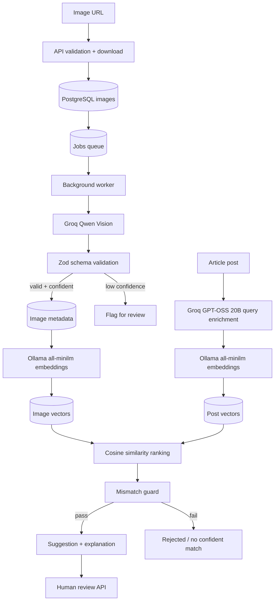

# FlyRank — AI Image Understanding & Content Matching Engine

A backend-first AI system that classifies an image library, embeds image descriptions and article text into a shared semantic space, ranks candidates, and rejects unsafe matches with an explicit explanation.

> Core product rule: **a wrong image is worse than no image**. A recommendation is surfaced only when confidence, semantic similarity, and declared subject/category constraints all pass.

## Features

- Groq Qwen 3.8 27B vision classification with structured JSON output and strict Zod validation.
- Groq GPT-OSS 20B article-query enrichment through the OpenAI-compatible Responses API.
- Low-confidence image classification is flagged for human review; it is never embedded or recommended.
- Local Ollama `all-minilm` text embeddings for image captions and article content; cosine similarity ranking.
- A standalone mismatch guard that checks confidence, similarity, category and canonical subject.
- PostgreSQL persistence and a `FOR UPDATE SKIP LOCKED` background job queue with retries.
- Per-call AI usage/cost ledger and a configurable daily call budget. Groq usage is recorded with model-specific estimated list pricing; local Ollama embeddings are recorded at $0 provider cost.
- Review endpoints, evaluation script, Docker Compose, health check and automated unit tests.

## Architecture



Layers: HTTP routes (`src/routes`) → services (`src/services`) → providers (`src/providers`) and persistence (`src/db`). The worker runs independently of the HTTP process.

## Requirements

- Docker Desktop with Docker Compose
- Node.js 20+ (for local development)
- Groq API key for vision and text-query enrichment, plus Docker for the local Ollama embedding model

## Quick start (Docker)

1. Revoke any Groq key previously pasted into chat. Copy `.env.example` to `.env` and set `GROQ_API_KEY` to a newly generated key. Do not commit `.env`.
2. Start the API, worker and PostgreSQL:

   ```bash
   docker compose up --build
   ```

3. In another terminal, seed sample article posts:

   ```bash
   docker compose exec api npm run seed
   docker compose exec api npm run seed:images
   ```

4. Check the API:

   ```bash
   curl http://localhost:3000/health
   ```

5. Add an image URL (JPEG, PNG or WebP):

   ```bash
   curl -X POST http://localhost:3000/api/images \
     -H 'Content-Type: application/json' \
     -d '{"image_url":"https://example.com/red-fox.jpg","filename":"red-fox.jpg"}'
   ```

   The API returns `202`; the worker downloads/analyses the image asynchronously. Poll `GET /api/images` until status is `processed` or `flagged`.

6. Create a post (or use a seeded one), then request matches:

   ```bash
   curl -X POST http://localhost:3000/api/posts \
     -H 'Content-Type: application/json' \
     -d '{"title":"Red foxes in forests","content":"Red foxes are mammals with orange coats and bushy tails.","expected_category":"animal","expected_subject":"red fox"}'

   curl -X POST http://localhost:3000/api/posts/POST_ID/match
   ```

7. Poll `GET /api/posts/POST_ID/images` for ranked suggestions and rejection reasons. If no candidate clears the guard, response status is `no_confident_match`.

## Local development

```bash
cp .env.example .env
npm install
# Start PostgreSQL separately, then:
npm run migrate
npm run seed
npm run dev       # API
npm run worker    # separate terminal
npm test
```

## API reference

| Method | Endpoint | Purpose |
|---|---|---|
| GET | `/health` | Database-backed health check |
| POST | `/api/images` | Validate and enqueue an image URL |
| GET | `/api/images` | List images and classification metadata |
| GET | `/api/images/:id` | Inspect an image |
| POST | `/api/images/:id/reprocess` | Enqueue image processing again |
| POST | `/api/posts` | Create an article/post |
| GET | `/api/posts` | List posts |
| GET | `/api/posts/:id` | Inspect a post |
| POST | `/api/posts/:id/match` | Queue matching for a post |
| GET | `/api/posts/:id/images` | Get ranked matches and guard explanations |
| POST | `/api/reviews/:suggestionId` | Approve/reject a suggestion (`action`, optional `note`) |
| GET | `/api/reviews` | Review history |
| GET | `/api/admin/jobs` | Queue status counts |
| GET | `/api/admin/costs` | AI call usage/cost breakdown |

All request bodies are validated at the API boundary. Invalid input returns a clean 4xx response. The API currently has no authentication; do not expose admin/review routes publicly without adding auth and tenant scoping.

## Dataset and evaluation

The capstone brief asks for at least 40 images across at least 4 categories and at least 10 manually labeled posts. This repository includes 10 starter posts. `npm run seed:images` imports up to 5 images from each of 8 Wikimedia Commons categories (up to 40 images), queues them for AI processing, and writes source/license metadata to `data/source-attribution.json`. Inspect the imported images and attribution before submission; category membership is not a substitute for visual verification. Do not treat arbitrary search results as licensed data.

For a defensible evaluation:

1. Add 40+ images, ideally 8–10 per category.
2. Wait until all images are `processed` or `flagged`.
3. Create at least 10 posts with explicit `expected_category` and `expected_subject`.
4. The seeded posts include `expected_subject` labels. Verify each post label against the imported corpus and adjust any labels that do not match your selected images.
5. Queue matching for all seeded posts with `docker compose exec api npm run match:all`, wait until jobs complete (`GET /api/admin/jobs`), then run `docker compose exec api npm run eval`. It computes top-1 precision against the declared subject labels. Report the evaluated-post count alongside precision.

Thresholds are environment-configurable. Tune them against the labeled set, not by guessing. The current defaults are conservative starter values, not measured production thresholds.

## Mismatch guard logic

A candidate is accepted only if all checks pass:

- Model confidence ≥ `LOW_CONFIDENCE_THRESHOLD`
- Cosine similarity ≥ `MIN_SIMILARITY_THRESHOLD`
- Category matches `expected_category`, when declared
- Canonical subject matches `expected_subject`, when declared
- Confidence-adjusted score (`similarity × confidence`) ≥ `MIN_MATCH_SCORE`

The subject check is intentionally strict and may reject semantically related but non-identical labels. For the demo, keep canonical labels consistent (e.g. `red fox`, `gray wolf`). A future improvement is a controlled taxonomy/alias table rather than fuzzy string matching.

## Reliability and security notes

- AI output is parsed and schema-validated before persistence. Invalid output is rejected.
- Jobs use row locking and retry with exponential delay; failed jobs retain the last error.
- API calls return quickly; slow vision/embedding work runs in a worker process.
- `GROQ_API_KEY` is read from environment only. Never commit `.env` or real credentials. Vision uses Groq Qwen 3.8 27B for vision and Groq GPT-OSS 20B for article-query enrichment; embeddings use the local Ollama `all-minilm` model.
- Image URL ingestion should be restricted further before production deployment (allowlisted hosts, DNS/IP checks, redirect validation, and download timeouts) to prevent SSRF.
- Add auth, per-user/tenant ownership, pagination, retention controls, and request-level idempotency before production use.
- Cost ledger records every successful provider call and failure events. Exact billed USD is not inferred; current configured provider estimated cost is recorded as zero and usage/duration are retained. Update pricing logic if using paid quota.

## Tests

```bash
npm test
```

Unit tests cover cosine similarity, schema validation, and mismatch guard behavior. Integration tests requiring PostgreSQL and a live Groq key remain to be added and run in the target environment.

## Limitations

- This is a backend capstone, not a finished multi-tenant SaaS.
- The image dataset and its license evidence must be supplied/verified by the project owner.
- Groq Responses API is currently documented as beta; configured provider quotas and model availability can change; model names are configurable.
- Embeddings are stored as JSONB arrays and searched in application memory. This is appropriate for the brief's small corpus (~50 images), not a large-scale vector database.
- No production authentication, upload UI, or live deployment is included.

## License

MIT. Dataset images remain subject to their individual source licenses and attribution requirements.
